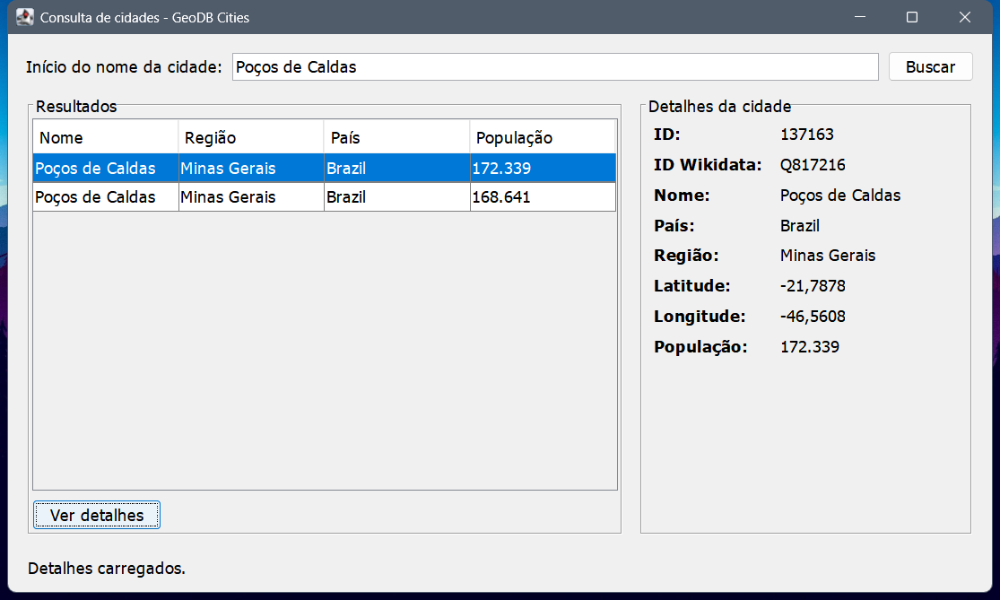

<div align="center">

# Busca de Cidades

**Cliente desktop em Java para a API REST GeoDB Cities**




</div>

## O que ele faz

Digite o início do nome de uma cidade, veja a lista de resultados e abra os detalhes de uma delas.

| Ação na tela | Chamada à API |
|---|---|
| **Buscar** | `GET /v1/geo/cities?namePrefix=...` |
| **Ver detalhes** | `GET /v1/geo/cities/{id}` |

## Antes de começar

- JDK 17 ou superior
- Apache NetBeans (ou Maven no terminal)
- Conta no [RapidAPI](https://rapidapi.com) com a API **GeoDB Cities** assinada (plano gratuito)

## Como rodar

**1. Clone o projeto**

```bash
git clone https://github.com/KlebersonResult/BuscaDeCidades.git
```

**2. Coloque sua chave da API**

Copie `config.exemplo.properties` para `config.properties` e preencha:

```properties
chave.api=SUA_CHAVE
```

> A chave fica em *My Apps → seu app → Security*, no RapidAPI.
> O `config.properties` não vai para o Git, então sua chave não fica exposta.

**3. Execute**

- **NetBeans:** *File → Open Project*, escolha a pasta e clique em *Run Project* (F6).
- **Terminal:**

  ```bash
  mvn clean package
  java -jar target/ClienteGeoDB.jar
  ```

## Teste rápido

1. Digite `Poços de Caldas` e aperte Enter.
2. Com a primeira linha selecionada, clique em **Ver detalhes**.
3. O painel da direita mostra ID, coordenadas e população.

## Como o código está organizado

| Arquivo | Função |
|---|---|
| `Principal` | Inicia o programa |
| `TelaPrincipal` | Tela (Swing) |
| `ClienteGeoDB` | Faz as chamadas GET à API |
| `Configuracao` | Lê a chave do `config.properties` |
| `Cidade` | Guarda os dados de uma cidade |
| `ErroApi` | Erros da API, com mensagem em português |

## Documentação

URLs, autenticação e exemplos de JSON de cada chamada estão em [`Documentacao.pdf`](Documentacao.pdf).
